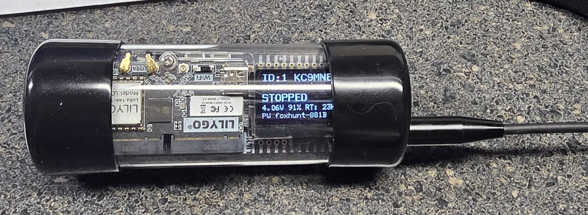
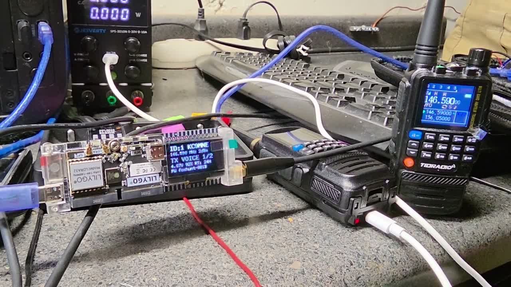

# Wi-F0X

**A phone-configured 2 m fox-hunt beacon for the LilyGO T-Beam Supreme 144-148 MHz.**
By Paul Gariepy, KC9MNE — [kc9mne.com](https://kc9mne.com)

Wi-F0X turns a stock T-Beam Supreme (ESP32-S3 + SX1278, 2 m version) into a fox for
transmitter hunts and ARDF. You set it up from a phone over its own Wi-Fi: no PC, no
programming cable, no app. It has been used at a real hunt alongside Byonics MicroFox 50s.




https://github.com/user-attachments/assets/96026c00-8a75-42aa-9971-1123c974c956

[](https://youtu.be/PTlThZ83Uh0)

The prototype on the bench sending a voice clip and tracking tones, received on a handheld.
[Watch on YouTube](https://youtu.be/PTlThZ83Uh0) (41 s), or
[download the MP4](https://github.com/kc9mne/esp32-Wi-F0X/raw/main/media/wi-f0x-demo-720p.mp4) (8 MB).

## Features

- **Beacon cycle:** tracking tone, optional Morse message, then `DE <call> FOX <n>` in CW.
- **Tracking modes:** steady tone, warble, repeating ARDF MO pattern (MOE, MOI, MOS, MOH,
  MO5 for fox 1-5), and a **MicroFox 50 sequence** mode that matches the MF-50's tones and
  timing so Wi-F0X can join an existing MF-50 rotation.
- **Voice clips:** upload audio from the phone (converted in the browser to 8 kHz mono WAV)
  and play one clip per cycle, true FM. Good for jokes, taunts, or announcements.
- **Phone control page:** frequency, power, tone length, interval, start delay, run limit,
  pitch, Morse speed, auto start, and start/stop/test buttons.
- **OLED status:** a KC9MNE Wi-F0X boot screen, then fox ID and call, frequency and power, beacon state with countdown,
  battery percent and estimated runtime, Wi-Fi name and password, and a Wi-Fi QR code.
- **Settings survive power-off** (stored in the ESP32's flash).
- **Power:** 2-10 dBm selectable. The CPU idles at 80 MHz and only steps up for voice.

## Hardware

- LilyGO **T-Beam Supreme, 144-148 MHz** version (SX1278). The 433/868/915 MHz versions
  will not work on 2 m.
- An 18650 cell (tested with a Samsung INR18650-35E).
- A 2 m antenna on the SMA. **Never transmit without an antenna.**
- Optional: a microSD card (FAT32) for voice clips.

### Enclosure

A clear tube with rubber end caps makes a see-through, water-resistant fox: you can read the
OLED without opening it, and the antenna comes out through one cap.

- **Tube:** [MECCANIXITY rigid clear polycarbonate tube](https://www.amazon.com/dp/B0BKQCXM6C),
  1.5 in (37.6 mm) ID, 1.6 in (40 mm) OD, 9.6 in (245 mm) long. One tube is enough for two foxes.
- **End caps:** [standard 1.5 in rubber end caps](https://www.amazon.com/dp/B07RGMFH9F), two per fox.

Cut the tube in half (about 4.8 in each) so the T-Beam (with its 18650) slides in, fit a cap on each end, and
pass the antenna through a hole in one cap. Pull a cap off to reach the power switch.

## Build and flash

Install [PlatformIO](https://platformio.org/), plug the T-Beam in over USB-C, then:

```bash
pio run -t upload
```

The first upload may need download mode: hold BOOT, tap RESET, release BOOT. After that
the firmware can put itself into download mode: send `b` over the USB serial port at
115200 baud, upload, then clear the force-download flag so it boots normally:

```bash
esptool.py --before no_reset --after hard_reset write_mem 0x6000812C 0 0xFFFFFFFF
```

Other serial commands: `t` sends one test cycle, `r` restarts, `h` runs a web self-test.

## Using it

1. Power on. The OLED shows the Wi-F0X boot screen, then the status screen.
2. Wi-Fi is on for 5 minutes after boot. Press **BOOT** to turn it on again later.
   Until a phone joins, the OLED alternates between the status screen and a **QR code**:
   point your phone camera at it to join the fox's network. The network name (`FOX-xxxx`)
   and password are shown beside the code for typing in by hand. Each fox makes its own
   random password on first boot (two letters and six digits, e.g. `kc482913`) and keeps it.
3. Open `http://192.168.4.1` on the phone.
4. Open **Settings**, enter **your callsign**, fox number, frequency and timing, and save.
   The callsign starts as the placeholder `F0X-01`: change it to yours before you transmit.
5. Press **Test** to send one cycle, then **Start**. With a start delay set, the fox waits
   before its first transmission (handy for MF-50-style sequencing).
6. For voice, open **Audio** and upload clips from your phone.

## How the audio works

- **Tones and Morse** use RadioLib's `AFSKClient`, toggling the SX1278's DIO2 data pin while
  the radio is in direct FSK transmit mode.
- **Voice** is true FM done in software: the SX1278's FastHop mode lets the frequency change
  while transmitting, so the ESP32 writes a new carrier frequency over SPI 8,000 times a
  second, offset by each audio sample (up to ±4 kHz, in 61 Hz steps). A second task reads
  the SD card into a double buffer so the card never interrupts the audio. See `playClip()`
  in `src/main.cpp`.

## Rules and safety

- You need an amateur radio licence to transmit on 2 m, and the fox must identify with
  **your** callsign. Wi-F0X sends the CW ID every cycle.
- Power is capped at 10 dBm in the firmware. The T-Beam's harmonics have not been measured;
  check yours with a spectrum analyser or service monitor before raising power or running
  long hunts.
- US rules don't allow LoRa on 2 m; Wi-F0X uses only FM/FSK tones and voice.

## Custom board (experimental)

`hardware/` holds a dedicated, smaller Wi-F0X board in KiCad 9: ESP32-S3, SX1278 at
+14 dBm, TP4056 charger and an 18650 on the back, sized to fit a 37.6 mm clear tube. It is
fully routed with JLCPCB order files, but **has not been built or tested**, and at small
quantities it costs more than a T-Beam. See [hardware/README.md](hardware/README.md).

## License

MIT — see [LICENSE](LICENSE). If you build on Wi-F0X, please keep the credit to KC9MNE.

73 de KC9MNE
